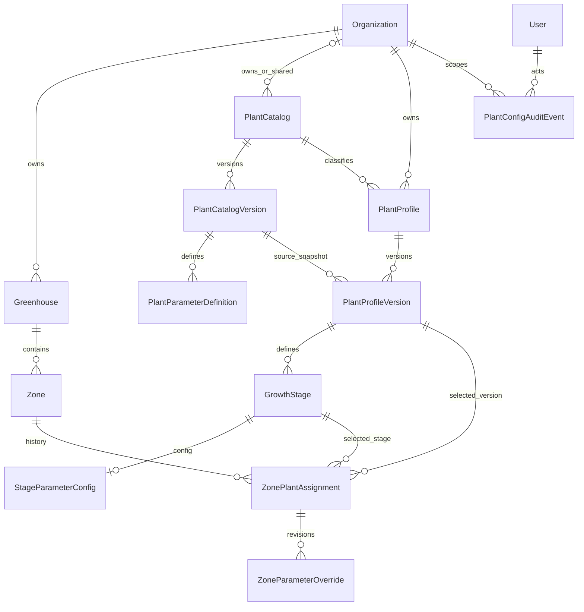

# Phase 10.1 — Revisi Proposal Domain Plant Standardization

**Status dokumen:** rancangan dan keputusan awal, bukan bukti bahwa implementasi atau test telah selesai.  
**Batas tinjauan:** source repository saat ini; tidak ada koneksi atau perubahan database dalam penyusunan dokumen.

## Ringkasan keputusan desain

1. Pertahankan `PlantCatalog` yang dapat berupa katalog bersama (`organizationId = null`) atau katalog milik organisasi. Jangan menambah `PlantSpecies` pada Phase 10.1.
2. Pertahankan konfigurasi JSON dan validasi JSON Schema. Definisi parameter, konfigurasi, dan schema harus terikat pada versi katalog/schema yang immutable setelah dipublikasikan/digunakan.
3. Jangan menentukan nilai agronomi, unit, rentang, durasi, atau rekomendasi sebelum persetujuan domain agronomi.
4. `GrowthStage` hanya mendefinisikan tahap dalam satu `PlantProfileVersion`. Otomatisasi perpindahan tahap ditunda.
5. Draft menggunakan optimistic concurrency berbasis revision. Pembuatan versi baru diserialisasi per profile.
6. Aktivasi memakai idempotency key, hash payload kanonis, transaksi serial per zone, dan constraint satu assignment aktif yang sudah ada.
7. Assignment tetap history-preserving, `PlantConfigAuditEvent` append-only, dan constraint satu assignment aktif per zone dipertahankan. Endpoint rollback khusus ditunda.
8. Tidak ada perubahan pada MQTT, telemetry, firmware, sensor/actuator metadata, atau perilaku kontrol.

## 1. Source yang diperiksa dan fakta saat ini

Semua path relatif terhadap root repository `D:\greenhouse-iot-phase6-auth\greenhouse-iot`.

- `apps/api/prisma/schema.prisma`: model `PlantCatalog` (`organizationId String?`), `PlantCatalogVersion`, `PlantParameterDefinition`, `PlantProfile`, `PlantProfileVersion`, `GrowthStage`, `StageParameterConfig`, `ZonePlantAssignment`, `ZoneParameterOverride`, dan `PlantConfigAuditEvent`. Catalog version menyimpan `profileDefaults` dan `stageTemplates` sebagai JSON; definisi menyimpan `dataType`, `unit`, `metadataSchema`, dan `valueSchema`; profile/stage/override menyimpan konfigurasi JSON. Profile version unik pada `(plantProfileId, version)`; stage unik pada `(plantProfileVersionId, code)` dan `(plantProfileVersionId, sequence)`. Assignment memiliki relasi komposit yang mengikat zone ke greenhouse, greenhouse ke organization, profile version ke organization, dan growth stage ke profile version.
- `apps/api/src/plants/plants.service.ts`: `validateProfileVersion` memvalidasi konfigurasi profile dan hasil merge per stage sebelum menyimpan status/checksum/audit; `createProfileVersion` menyalin versi terakhir; `updateProfileDraft` dan update stage mengubah draft dalam transaksi; `activateZone` memeriksa membership, zone/organization, versi validated, dan stage/version sebelum menutup assignment aktif dan membuat assignment baru dalam transaksi; `requireOrganization` memberi hak pengelolaan kepada OWNER/ADMIN.
- `apps/api/src/plants/plant-config.ts`: schema dialect JSON Schema Draft 2020-12; AJV strict; object parameter menolak key tambahan; `metadataSchema` menyediakan `required` dan `nullable`; merge precedence yang digunakan adalah profile → stage → zone override; checksum SHA-256 atas JSON terkanonisasi.
- `apps/api/src/plants/dto/plant.dto.ts`: parameter DTO menyimpan `dataType`, `unit` string opsional, `valueSchema`, dan `metadataSchema`; draft update belum membawa revision; activation DTO saat ini menerima `organizationId`, `plantProfileVersionId`, dan `growthStageId`, belum idempotency key.
- `apps/api/prisma/migrations/20261014100000_phase10_1_plant_standardization/migration.sql`: constraint assignment aktif tunggal `zone_plant_assignments_one_active_per_zone` (partial unique index pada `zoneId` untuk status ACTIVE), state check status/`endedAt`, composite FK, trigger assignment version tervalidasi dan identity immutable, trigger profile/stage immutable setelah validasi, trigger audit append-only.
- `apps/api/prisma/migrations/20261016100000_tenant_plant_catalog/migration.sql`: menambah `organizationId`, scoped unique index tenant dan unique partial index catalog legacy `organizationId IS NULL`, serta trigger bahwa profile hanya boleh memakai katalog global atau katalog milik organization yang sama.
- Test yang diperiksa: `apps/api/src/plants/plant-migration.spec.ts`, `tenant-catalog.migration.spec.ts`, `plant-config.spec.ts`, `parameter-definition.service.spec.ts`, `plants.service.spec.ts`, `plants.controller.spec.ts`, dan `apps/api/test/plants.integration.e2e-spec.ts`. Integration test mencakup autentikasi, role OWNER/ADMIN, isolasi lintas tenant, proteksi versi tervalidasi, validasi aktivasi, override, dan audit. Test tersebut diperiksa sebagai source; tidak dijalankan.

## 2. Domain model dan relasi yang dipertahankan

Relasi mengikuti model yang ada. `PlantCatalog` adalah identitas katalog; `PlantCatalogVersion` membawa kontrak definisi dan defaults bertanggal versi; `PlantProfile` dimiliki organization; `PlantProfileVersion` menunjuk sumber katalog versi tertentu dan menjadi snapshot tenant; setiap stage hanya milik satu profile version; assignment memilih versi dan stage untuk satu zone.

Katalog global dibaca sebagai `organizationId = null`. Katalog baru yang dibuat oleh API organization bersifat tenant-owned. Tidak mengasumsikan global catalog dapat diedit oleh tenant. Akses katalog global dan pengelolaan katalog platform tetap mengikuti permission/platform guard yang ada.

## 3. Kontrak JSON Schema dan semantik unit

- Pertahankan JSON untuk `profileDefaults`, `stageTemplates`, `profileConfig`, konfigurasi stage, dan zone override.
- `configSchemaVersion` mengidentifikasi kontrak konfigurasi, misalnya versi yang saat ini digunakan `plant-config/v1`. Nilai schema dialect yang saat ini diwajibkan adalah `https://json-schema.org/draft/2020-12/schema`.
- Setiap `PlantParameterDefinition` tetap mempunyai `parameterKey`, `dataType`, `unit?`, `valueSchema`, dan `metadataSchema`. Source memeriksa bahwa `dataType` cocok dengan `valueSchema.type`, membatasi tipe yang didukung, memeriksa batas minimum/maksimum yang masuk akal, dan menerapkan `required`/`nullable` dari metadata saat menyusun object schema.
- Config JSON harus object dengan key yang terdefinisi; schema object hasil builder menggunakan `additionalProperties: false`. Nilai dicek dengan AJV saat edit layer dan saat validasi versi/effective config. Schema tidak boleh diambil secara remote saat runtime; schema disimpan dan dipakai berdasarkan versi katalog yang dirujuk.
- Unit saat ini hanya string opsional, bukan kode registry atau unit yang dapat dikonversi. Phase 10.1 mendokumentasikan unit persis sebagaimana disetujui pemilik domain; tidak mengkonversi atau membandingkan nilai lintas unit. Registry, dimensi, konversi dan presisi adalah keputusan terbuka.
- Perubahan definisi yang telah dipublikasikan tidak dilakukan in-place. Buat versi katalog baru dan definisi baru; profile baru/adopsi mencatat `sourceCatalogVersionId` dan `configSchemaVersion`. Profile version yang validated tidak diedit. Validasi harus memakai definisi dari sumber versi yang dipin, bukan definisi terkini yang berubah.
- Checksum mencakup kontrak/schema version dan konten config. Algoritma aktual helper adalah SHA-256 atas canonical JSON; field default schema mencantumkan `SHA-256/JCS-RFC8785`. Sebelum implementasi tambahan, pertahankan test vectors dan jangan mengubah interpretasi/canonicalization tanpa versi/keputusan kompatibilitas.
- Tidak ada contoh nilai agronomi, unit tertentu, atau batas numerik yang ditetapkan dalam proposal ini.

## 4. Lifecycle draft / validated / retired

- **DRAFT:** editable. Saat membuat profile, versi awal dibuat draft. Membuat revisi dari versi validated menyalin snapshot dan stages terakhir menjadi draft baru; source saat ini mengambil versi tertinggi dan menggunakan nomor `prior.version + 1`.
- **VALIDATED:** validation service memeriksa adanya minimal satu stage, validates profile layer, lalu memvalidasi konfigurasi efektif profile + setiap stage terhadap definisi yang pinned. Dalam transaksi, checksum config stage/profile disimpan, status menjadi VALIDATED, validator/waktu dicatat, dan audit event ditambahkan. Migrasi mencegah perubahan konten versi/stage/config tervalidasi dan melarang delete history.
- **RETIRED:** status untuk menghentikan pemakaian baru sesuai policy; data/version tetap ada untuk assignment dan audit historis. Migrasi melindungi immutability dan melarang re-publish pada catalog retired. Kebijakan aktivasi versi profile retired perlu dipastikan sebelum penerapan retirement behavior.
- Validasi dan immutability adalah batas perubahan kontrak. Perubahan konfigurasi setelah validated harus melalui draft versi berikutnya, bukan update snapshot lama.

### Optimistic concurrency untuk draft dan sealing

**Rancangan wajib untuk Phase 10.1A:** tambahkan `draftRevision Int` pada `PlantProfileVersion` (awal 1). Revision ini adalah compare-and-swap token untuk semua mutasi isi draft: profile config/name bila termasuk snapshot, create/update/delete stage, stage config, dan operasi turunan lain. API mengembalikan `draftRevision`; setiap mutasi menerima `expectedRevision`.

Dalam transaksi, mutasi claim revision secara kondisional pada parent: `id + organizationId + status=DRAFT + draftRevision=expectedRevision`, kemudian naikkan revision dan tulis perubahan child/config serta audit dalam transaksi yang sama. Kegagalan claim tidak menulis perubahan. Lakukan query tenant-scoped untuk membedakan resource tak ditemukan/tidak berhak (404/403 sesuai pola API) dari revision/status stale (`409 Conflict`). Revision terbaru hanya boleh disertakan dalam body 409 setelah akses resource diverifikasi. Jangan mengirim versi/config lintas tenant.

**Validasi/sealing juga memakai CAS.** Request validasi wajib membawa `expectedRevision`. Dalam transaksi, lock/claim parent version dengan revision tersebut, baca ulang profile config, seluruh stage/config dan definisi katalog versi yang dipin dari snapshot transaksi, lalu validasi snapshot itu. Hitung checksum dari byte-semantik JSON kanonis yang sama dan `configSchemaVersion` yang digunakan validasi. Sebelum commit, transisikan `DRAFT → VALIDATED` secara kondisional dengan revision yang sama dan checksum hasil snapshot; simpan validator/time dan audit event dalam transaksi yang sama. Tidak boleh menghitung checksum dari object yang dibaca sebelum lock lalu menyegel row yang mungkin telah berubah. Jika revision/status tidak cocok, abort seluruh transaksi dan kembalikan 409. Invarian: isi yang divalidasi, checksum tersimpan, dan revision yang disegel identik.

### Pembuatan profile version secara bersamaan

Gunakan transaksi PostgreSQL dan lock row parent `PlantProfile` yang scope-nya mencakup `id` dan `organizationId`, dengan urutan lock yang konsisten. Setelah lock didapat, baca ulang versi tertinggi dan status draft di transaksi tersebut. Buat `max(version)+1` hanya jika versi terakhir dapat menjadi base dan tidak ada draft terbuka. Unique `(plantProfileId, version)` tetap sebagai backstop; bila constraint konflik setelah state dibaca ulang, kembalikan konflik domain 409, jangan membuat versi pengganti otomatis.

Dua request create-version akan diserialisasi pada row profile: request pertama membuat draft; request kedua setelah memperoleh lock melihat draft itu dan mendapat 409 (satu draft terbuka per profile). Snapshot base dan audit dibuat dalam satu transaksi. Source sekarang membaca versi tertinggi sebelum transaksi dan menghitung `prior.version + 1`, sehingga lock/re-read tersebut belum tersedia.

### Transaksi, isolation, lock order, dan retry

Provider aktual adalah PostgreSQL (`apps/api/prisma/schema.prisma`, datasource `db`). Transaksi Prisma saat ini tidak menetapkan `isolationLevel`; rancangan tidak menganggap serializable sebagai perilaku yang sudah aktif. Untuk 10.1A, tetapkan secara eksplisit strategi PostgreSQL: gunakan transaksi `READ COMMITTED` dengan row lock sebagai serialisasi untuk operasi per-profile/per-zone, lalu baca ulang semua state setelah lock. Jangan campur lock order antar operasi. Urutan yang disarankan: (1) row `Zone` atau `PlantProfile` parent yang telah tenant-scoped, (2) row profile-version/assignment terkait dalam urutan id stabil bila perlu, (3) reservation idempotency/event, (4) tulis audit. Validasi version hanya mengunci parent version; jangan mengambil lock profile setelah version.

Deadlock tetap mungkin saat beberapa transaksi menyentuh beberapa resource atau unique-index yang sama. Batasi retry ke maksimum **3 percobaan total** (percobaan awal + paling banyak dua retry), hanya untuk konflik transaksi PostgreSQL yang teridentifikasi aman diulang: SQLSTATE `40P01` (deadlock detected), `40001` (serialization failure bila isolation/operasi kelak menggunakannya), atau Prisma `P2034` hanya jika terbukti merupakan pemetaan write conflict/deadlock tersebut. Jangan retry validation/domain error, stale revision, authorization error, `P2002` secara umum, atau error koneksi/commit dengan hasil tak diketahui tanpa terlebih dahulu memeriksa reservation idempotency. Konflik unique idempotency ditangani sebagai lookup/replay, bukan retry operasi sebagai create baru. Setelah tiga percobaan gagal, kembalikan respons retryable yang stabil (mis. 503 dengan `Retry-After`) dan jangan bocorkan detail SQL. Gunakan jeda terbatas/backoff untuk retry; key dan payload yang sama dipertahankan.

Pemetaan kode error Prisma/PostgreSQL harus diverifikasi terhadap versi Prisma yang dipakai saat implementasi. Daftar ini adalah rancangan allow-list, bukan klaim bahwa retry handler sudah ada.

## 5. Growth stage: cakupan dan batasan

`GrowthStage` tetap child dari `PlantProfileVersion`, memiliki `code`, `label`, `sequence`, opsional `minDurationDays`, `maxDurationDays`, dan `transitionCriteria`; `StageParameterConfig` menyimpan JSON config untuk stage. Unique `(plantProfileVersionId, code)` dan `(plantProfileVersionId, sequence)` menjaga identitas/order dalam versi. Immutability trigger melindungi stage/config setelah parent validated.

Phase 10.1 hanya membuat, mengedit, menyalin, dan memvalidasi definisi stage di dalam draft/validated version. Tidak mengaktifkan mesin yang memutuskan kapan tanaman berpindah tahap, tidak menafsirkan `transitionCriteria` secara otomatis, dan tidak membuat klaim agronomi tentang durasi. Penetapan stage untuk suatu zone terjadi eksplisit sebagai bagian dari assignment. Perpindahan stage otomatis/manual setelah aktivasi dan event riwayat stage ditunda sampai model crop-cycle, aktor, sebab, timestamp, dan transisi yang sah disepakati.

## 6. Zone assignment dan activation history

`ZonePlantAssignment` adalah state/history per aktivasi: zone, greenhouse, organization, validated profile version, stage yang berasal dari versi tersebut, actor, `activatedAt`, status, dan `endedAt`. Aktivasi baru mengakhiri assignment ACTIVE sebelumnya lalu membuat row ACTIVE baru. Row assignment tidak dihapus; identitasnya immutable dan hanya lifecycle status/timestamp yang berubah. Database sudah menegakkan satu assignment aktif per zone dan pasangan status/`endedAt`.

`ZonePlantAssignment` disebut **history-preserving**, bukan append-only row: row aktif diperbarui menjadi ENDED/CANCELLED, sedangkan identitasnya immutable dan delete ditolak. `PlantConfigAuditEvent` tetap append-only. Transaksi aktivasi/deaktivasi menulis state assignment, ledger idempotency/event, dan audit relevan atomik.

Untuk idempotency, usulkan ledger operasi `ZoneActivationRequest`/`ZoneActivationEvent` dengan hasil operasi awal yang persisten. Ledger ini belum tersedia di schema. Setiap record menyimpan scope key, canonical request hash, peminta awal (`actorUserId`), status/result yang cukup untuk replay (termasuk assignment/event ID dan response awal), serta waktu. Retensi ledger adalah keputusan konfigurasi dan harus disetujui sebelum implementasi; jangan melakukan purge otomatis sebelum kebijakan disahkan.

## 7. Idempotency dan aktivasi bersamaan

### Idempotency contract yang diusulkan

- Wajibkan header `Idempotency-Key` pada endpoint aktivasi dan deaktivasi. Unique scope tepat `(organizationId, operation, idempotencyKey)`. Actor dicatat sebagai peminta awal tetapi **bukan** bagian unique scope. Setiap replay wajib menjalankan autentikasi dan authorization saat ini untuk organization/resource sebelum lookup/result dikembalikan; key bukan credential.
- Buat hash dari payload semantik yang dinormalisasi: operation, organization terverifikasi, zone ID, profile version ID, growth stage ID, dan reason bila reason bagian dari request; untuk deactivate gunakan assignment ID. Gunakan canonical JSON/checksum; abaikan header transport dan urutan properti.
- Key sama + hash sama + operasi tersimpan COMPLETED mengembalikan response awal yang persisten, bukan membaca/menyajikan status assignment terkini. Tidak membuat assignment atau audit duplikat. Key sama + hash berbeda selalu 409.
- Reservasi key, perubahan assignment, completion/result, dan audit berada dalam **satu transaksi**. Insert reservation dengan unique scope. Request identik yang datang bersamaan akan menunggu unique index/transaksi pertama: jika transaksi pertama commit, request kedua membaca record selesai dan replay; jika transaksi pertama rollback, request kedua dapat memperoleh reservation dan menjalankan operasi. Tidak ada status IN_PROGRESS yang terlihat di luar transaksi. Timeout menunggu bukan payload mismatch; beri respons retryable dan caller boleh mengulang key sama.
- Jika commit result tidak diketahui karena koneksi terputus, jangan mengirim operasi baru/key lain. Query reservation dengan scope key dan bandingkan hash setelah authorization; completed + hash sama berarti replay, hash beda berarti 409, belum ditemukan berarti request dengan key sama dapat dicoba lagi sesuai kebijakan API.
- Peminta awal dicatat sebagai `actorUserId`; actor tidak masuk unique scope. Aktor berbeda yang kini terotorisasi boleh menerima hasil awal jika hash sama. Authorization selalu diperiksa terlebih dahulu. Hasil tersimpan mempertahankan atribusi peminta awal; jangan menyamarkan actor pemanggil sekarang sebagai actor yang melakukan operasi.
- Retensi idempotency ledger belum ditetapkan: konfigurasi retensi harus disetujui sebelum implementasi. Jangan purge otomatis, dan jangan menghapus ledger saat kebijakan retensi belum ada. Batas key, format, response immutable dan penanganan hasil yang sedang berlangsung (tidak terlihat selama transaksi) perlu dicakup kontrak API.

### Transaksi dan aktivasi paralel

1. Autentikasi/authorization OWNER/ADMIN terhadap organization dan zone. Di transaksi PostgreSQL, lock row `Zone` tenant-scoped menggunakan `SELECT ... FOR UPDATE`; semua aktivasi/deaktivasi menggunakan urutan lock yang sama.
2. Setelah lock, baca ulang zone dan assignment state. Verifikasi zone belum dihapus, organization dari relasi zone→greenhouse cocok, target version VALIDATED, dan stage milik versi tersebut. Ambil lock kompatibel-baca pada profile version selama keputusan aktivasi agar retirement bersamaan tidak mengubah status di tengah transaksi. Jangan gunakan `current assignment` yang dibaca sebelum transaksi.
3. Claim/retrieve reservation key. Bila key telah selesai: hash sama menghasilkan response awal; hash berbeda 409. Bila request pertama masih berjalan, unique index membuat request kedua menunggu; tidak ada partial state yang terlihat.
4. Untuk operasi baru, validasi payload/effective config terhadap snapshot immutable yang dipin; akhiri assignment ACTIVE lama, buat assignment baru, selesaikan ledger dengan result immutable, dan tulis `PlantConfigAuditEvent` dalam transaksi yang sama. Tidak ada side effect eksternal/MQTT dalam transaksi.
5. Partial unique index satu ACTIVE per zone adalah backstop. Dua request berbeda-key akan serial oleh lock zone; operasi kedua membaca state hasil commit pertama lalu melakukan aktivasi baru sesuai request. Konflik state/domain tetap 409. Error deadlock/serialization yang allow-listed dicoba ulang sampai maksimum tiga percobaan total dengan key sama; selain itu gagal tertutup tanpa perubahan parsial.
6. Deaktivasi menggunakan urutan lock yang sama. Request key baru untuk assignment yang sudah berakhir menghasilkan 409; replay key yang sebelumnya sukses tetap memberikan response awal tersimpan, bukan status terkini.

Row-lock, isolation eksplisit, ledger, retry, revision CAS, dan respons API di atas adalah perubahan yang diwajibkan, bukan mekanisme yang diklaim tersedia. Implementasi sekarang memakai PostgreSQL dan `$transaction` tanpa isolation option yang tampak pada service, membaca current assignment sebelum transaksi di `activateZone`, belum mempunyai idempotency key/ledger, dan belum mempunyai `draftRevision`/`expectedRevision`.

## 8. Tenant isolation dan audit

- Scope organisasi diturunkan dari membership dan relasi resource; `organizationId` dari body hanya input yang harus diverifikasi terhadap zone/profile.
- Plant service menerapkan membership check dan OWNER/ADMIN untuk pengelolaan. Tenant-scoped queries dan FK komposit memberi lapisan isolasi; cross-tenant resource mengikuti pola not-found/forbidden yang diuji integration test.
- Catalog tenant hanya dapat dipakai profile dari organization yang sama; catalog global dapat direferensikan lintas tenant sesuai perilaku `organizationId = null` dan kebijakan akses global.
- Pertahankan trigger append-only `PlantConfigAuditEvent`, audit actor/org/entity/checksum/request ID, audit dalam transaksi perubahan, dan jangan mencatat konfigurasi agronomi sensitif secara berlebihan pada details.
- Jalankan ulang pemeriksaan authorization pada idempotent replay; jangan membocorkan adanya key/resource di tenant yang caller tidak punya aksesnya.

## 9. Strategi migrasi additive dan backward compatibility

Rancangan optimistic concurrency memerlukan kolom revision; idempotency memerlukan activation ledger/key/hash/result. Jika disetujui, buat migration additive berikutnya: tambah revision dengan default kompatibel dan tabel/index/FK/triggers/retention controls yang diperlukan. Jangan ubah/hapus JSON columns, assignment history, event audit, catalog legacy rows, atau kontrak MQTT. Ledger tidak boleh memiliki purge job sampai keputusan retensi disetujui.

Deployment bertahap: schema additive lebih dahulu; aplikasi kompatibel membaca data lama dan baru; endpoint mengeluarkan/ menerima token revision/idempotency setelah schema tersedia; baru wajibkan kontrak pada mutasi baru. Tidak perlu backfill nilai agronomi. Backfill ledger idempotency untuk event lama tidak dapat merekonstruksi request hash; event lama tetap berstatus non-idempotent historical event dan tidak boleh diberi hash rekaan.

CI migration plan (belum dijalankan): upgrade dari migration state yang didukung serta fresh install pada disposable PostgreSQL; periksa unique/partial index, composite FK, check constraint, trigger, dan rollback aplikasi dengan tabel additive tetap ada. Roll-forward untuk additive change lebih aman. Tidak ada migration rollback yang boleh menghapus assignment atau audit immutable. Uji API lama/baru dalam masa deploy campuran dan pastikan MQTT/firmware/telemetry tidak berubah.

## 10. Rencana pengujian (belum dijalankan)

- **Unit JSON/config:** dialect Draft 2020-12, tipe schema vs `dataType`, unknown key, required/nullable, bounds schema, konfigurasi tak finite, precedence profile→stage→override, canonical checksum dan perubahan schema version.
- **Unit lifecycle:** draft CAS revision berhasil/gagal stale; semua operasi stage menaikkan revision parent; validasi dengan expected revision memvalidasi/checksum snapshot persis yang disegel; edit bersamaan membuat validasi atau edit lain 409 tanpa perubahan parsial; satu draft per profile dan nomor versi bertambah.
- **Unit idempotency:** scope unik organization+operation+key; actor awal tersimpan tapi tidak di scope; canonical-equivalent payload replay; payload mismatch 409; response tersimpan tetap response awal setelah assignment berubah; authorization denial mencegah replay; status in-flight/unique-wait dibedakan dari mismatch.
- **Integration concurrency draft:** dua edit dengan expected revision sama menghasilkan tepat satu commit; edit vs sealing tidak dapat menyegel snapshot berbeda; dua create-version paralel menghasilkan satu draft dan satu 409.
- **Integration activation concurrency:** dua key berbeda untuk zone sama menghasilkan serialisasi deterministik dan maksimal satu ACTIVE; key sama bersamaan menghasilkan satu assignment/event/audit dan response awal identik; key sama beda payload 409; reservation first transaction rollback mengizinkan request kedua menjalankan operasi; request tunggu timeout tidak diklasifikasikan mismatch.
- **Failure injection:** gagal setelah reservation, setelah end prior assignment, setelah create assignment, setelah audit, dan saat commit; setiap error membuktikan transaksi atomic. Simulasikan SQLSTATE `40P01`, `40001`, mapped P2034, P2002 non-idempotency, authorization/domain errors, timeout, dan koneksi dengan commit outcome unknown. Buktikan hanya error allow-listed diretry (maksimum 3 total), P2002 dibaca sebagai reservation conflict bila relevan, dan tidak ada event/audit duplikat.
- **Locking/deadlock integration:** lock order konsisten untuk create-version/edit/validate dan activate/deactivate; konkurensi multi-zone/multi-profile memeriksa deadlock; pastikan hasil akhir dan retry aman. Jangan menandai test ini selesai sebelum dijalankan di database PostgreSQL disposable CI.
- **Security/tenant:** cross-organization catalog/profile/version/stage/zone, body organization spoof, replay key lintas tenant/role, revoked membership/grant, audit visibility, ID enumeration response.
- **Migration/backward compatibility:** fresh install, upgrade chain, global catalog null-owner preservation, tenant uniqueness, trigger/FK/index invariants, existing JSON snapshots tetap dapat dibaca/dihash, serta perilaku API pada deployment versi campuran.

## 11. Keputusan domain yang masih terbuka

1. Apakah profile version yang RETIRED dapat diaktifkan kembali? Bagaimana syarat keselamatan dan siapa yang berwenang?
2. Apa arti `unit` dan aturan mana yang authoritative; apakah diperlukan registry dan konversi unit pada fase lanjutan?
3. Siapa yang menyetujui parameter definitions/schema serta perubahan `configSchemaVersion`?
4. Apakah pemisahan author dan validator diperlukan? Peran mana yang boleh aktivasi/deaktivasi?
5. Apa format dan batas panjang `Idempotency-Key`, canonical payload fields, serta bentuk response awal immutable yang harus disimpan?
6. Berapa kebijakan retensi ledger? Persetujuan ini wajib sebelum implementasi dan sebelum purge otomatis apa pun.
7. Apakah response replay lintas aktor mengembalikan atribusi actor awal di body atau hanya menyimpannya untuk audit? Actor awal tetap tersimpan dan tidak diganti actor replay.
8. Apa kebijakan untuk versi katalog/profile archived/retired yang masih digunakan assignment historis?
9. Apakah perubahan stage setelah aktivasi kelak manual atau otomatis, dan bagaimana event/provenance-nya?
10. Berapa lama audit config disimpan dan bagaimana penghapusan organisasi/aktor berinteraksi dengan audit immutable?
11. Nilai agronomi, parameter wajib, tipe, unit, rentang, presisi, dan durasi apa yang disetujui agronom? **Belum diputuskan; tidak boleh ditebak.**

## 12. Out of scope Phase 10.1

- Model `PlantSpecies` baru atau pemecahan katalog bersama/tenant.
- Normalisasi typed parameter values atau unit-conversion registry; JSON Schema tetap kontrak Phase 10.1.
- Nilai/rekomendasi agronomi.
- Otomatisasi growth-stage progression, engine transisi, dan riwayat transisi tahap.
- Endpoint/workflow rollback khusus. Kebijakan versi historis yang boleh diaktifkan dan kebutuhan audit harus disetujui dahulu; bila rollback kelak dibuat, ia harus membuat activation baru dan tidak menulis ulang history lama.
- Rule engine, decision manager, MQTT configuration delivery, firmware, telemetry, sensor/actuator metadata changes.
- Perubahan authentication guard atau tenant model.

## Kriteria penerimaan spesifikasi

- Proposal menggunakan model katalog/profile/version/stage/assignment yang ada dan tidak mengusulkan `PlantSpecies` pada fase ini.
- Kontrak JSON Schema/schema version dan batas unit terdokumentasi; tidak ada nilai agronomi rekaan.
- Seluruh draft mutation dan validasi menggunakan `draftRevision` CAS; checksum, snapshot tervalidasi, dan revision sealed identik; stale-write menjadi 409 tanpa kebocoran tenant.
- Pembuatan versi mengunci parent profile tenant-scoped, membaca ulang state, menegakkan satu draft terbuka, dan mempertahankan unique version constraint.
- Aktivasi/deaktivasi menggunakan unique scope organization+operation+key, canonical payload hash, actor awal, replay hasil awal, mismatch 409, dan persistensi atomik assignment+ledger+audit.
- Zone lock dan urutan lock dinyatakan, partial unique index tetap menjadi backstop, serta retry error allow-listed dibatasi tiga total.
- Assignment history-preserving dengan identitas immutable serta audit append-only; rollback endpoint secara eksplisit ditunda.
- Open questions disetujui sebelum implementasi. Dokumen ini tidak menyatakan implementasi maupun test selesai.

