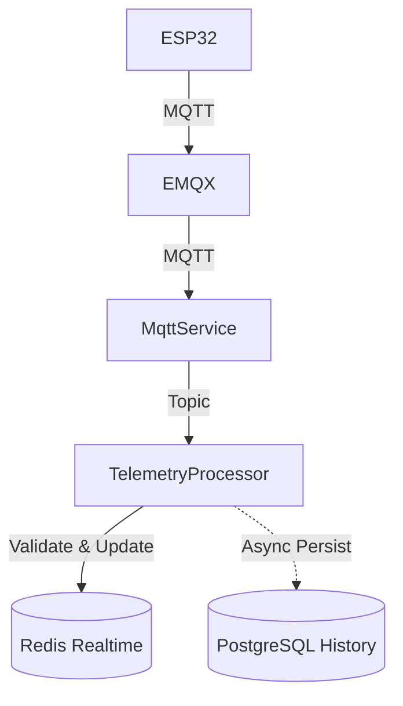

# Telemetry Pipeline Documentation

## 1. Architecture

The telemetry pipeline uses a fast realtime path via Redis and an asynchronous persistence path via PostgreSQL to minimize latency.

Approved Phase 10.5 rule sets are evaluated asynchronously from this telemetry stream in dry-run mode. See [the Rule Engine/Decision Manager contract](phase10/PHASE_10_5_RULE_DECISION_MANAGER.md); it adds no MQTT topic or automatic actuator publish.



- **MqttService**: Handles MQTT connections, subscriptions, and raw payload forwarding.
- **TelemetryProcessor**: Validates structure, sequences, bounds, and routes data.
- **TelemetryRealtimeService**: Maintains the latest device state in Redis with a TTL of 1 hour.
- **TelemetryPersistenceService**: Persists historical data to PostgreSQL and logs device status.

## 2. MQTT Topic & Payload Schema

- **Topic**: `greenhouse/{greenhouseId}/{deviceId}/telemetry`
- **Topic Parser**: Uses `parseGreenhouseTopic` (from `mqtt.constants.ts`) to ensure single-source-of-truth.

### Payload Schema
```json
{
  "seq": 12345,
  "ts": 1780270000000,
  "sensors": [
    {
      "code": "TEMP01",
      "value": 28.5,
      "unit": "°C"
    }
  ]
}
```

## 3. Validation

- **Device Validation**: The payload is cross-referenced with PostgreSQL. Telemetry is dropped from persistence if the `deviceId` isn't registered to the `greenhouseId`.
- **Sensor Validation**: Unknown sensors are ignored gracefully; valid sensors are persisted.
- **Timestamp Validation**: Device timestamps are verified not to exceed current time + 1 hour tolerance.
- **Idempotency & Deduplication**: Managed using `deviceId` + `sequence`. Duplicates are dropped at the Processor layer and protected by a `@@unique([deviceId, sequenceNumber])` constraint in PostgreSQL.
- **Out of Order Handling**: Older sequences skip the realtime Redis update to prevent stale data overlay, but are persisted to PostgreSQL for historical completeness.

## 4. State & Lifecycle

- **Redis Keys**: 
  - `realtime:device:{deviceId}` (Stores JSON state)
  - `realtime:greenhouse:{greenhouseId}:devices` (Set of devices)
- **TTL**: 3600 seconds.
- **Online/Stale/Offline**: Calculated dynamically based on `lastSeenAt`.
  - `ONLINE`: <= 15s
  - `STALE`: > 15s and <= 30s
  - `OFFLINE`: > 30s

## 5. PostgreSQL Schema

Two main models:
- **TelemetryRecord**: Contains raw payload, device info, sequence, and timestamps.
- **TelemetryValue**: Normalizes the sensors array into individual rows for efficient granular queries.

## 6. Failure Handling

- **Redis Failure**: MQTT consumer will not crash; errors are logged (`[REALTIME_ERROR]`), and persistence continues asynchronously.
- **PostgreSQL Failure**: Persistent layer is asynchronous; DB failures trigger structured logging (`[PERSIST_ERROR]`) without interrupting the realtime Redis flow.
- **EMQX Disconnects**: `MqttService` handles auto-reconnects and subscription restores seamlessly.

## 7. APIs

- **`GET /api/devices/:id/telemetry/latest`**: Fetches dynamic state from Redis.
- **`GET /api/greenhouses/:id/telemetry/latest`**: Fetches realtime snapshot of all devices in greenhouse.
- **`GET /api/devices/:id/telemetry/history`**: Paginated Postgres fetch. Supports `limit`, `from`, and `to` query parameters.

## 8. Benchmark Profile
The architecture splits realtime (fast path) and history (async path) making the node process capable of easily handling 100+ msg/sec without blocking the event loop or generating realtime response latency.

## 9. Monitoring-only plant configuration

The Plant Setup page can apply a published catalog's selected sensor parameters to a compatible
ESP32-S3. This is a separate protocol from actuator commands:

- API publishes to `greenhouse/{greenhouseCode}/{deviceId}/config` at QoS 1, without retain.
- Firmware only subscribes to `/config`; the existing ON/OFF handler remains subscribed only to
  `/command`.
- A monitoring payload uses `schema: "plant-monitoring/v1"`, `mode: "monitoring_only"`, a unique
  `configurationId`, increasing per-device `version`, the published `catalogVersionId`, parameter
  keys, and an allowlisted sensor-code list. It contains no actuator fields.
- Firmware validates the schema and sensor mapping, stores the selection in NVS, then sends
  `RECEIVED` and `APPLIED` acknowledgements on `/response` with `type: "plant_config"`.
- API state distinguishes `PUBLISHING`, `SENT`, `RECEIVED`, `APPLIED`, `REJECTED`, `TIMEOUT`, and
  `FAILED`. A successful broker publish is not an applied-device acknowledgement.

The current firmware exposes `temperature`, `humidity`, `soil_moisture`, and `light_intensity`.
The backend maps catalog keys `air_temperature`, `relative_humidity`, `soil_moisture`, and
`light_intensity`; its telemetry unit is `lux`. AI Plant Setup includes `light_intensity` as a
candidate parameter and fixes its displayed unit to `lux`. Firmware reports simulated light readings
by default and sets `sensorDataMode` from `USE_PHYSICAL_SENSORS`; when physical sensors are enabled,
the LDR conversion is only an estimate and must not be treated as calibrated lux without
hardware-specific calibration. Other catalog parameters (including pH, TDS, and water temperature)
are rejected until firmware and registered sensor support exist. `sensorDataMode: "SIMULATED"` is
not evidence that physical sensors are installed or calibrated.

Firmware `1.1.0-esp32s3` advertises `capabilities.plantConfiguration: "plant-monitoring/v1"` on
every `/status` heartbeat and subscribes to the separate `/config` topic. Source code changes do
not update a controller already in service: compile and upload
`firmware/esp32_s3_greenhouse/esp32_s3_greenhouse.ino` to the ESP32-S3, reconnect it to MQTT, and
wait for a fresh heartbeat. Confirm the reported firmware is `1.1.0-esp32s3` and the monitoring
capability is present before applying configuration. If the device still shows an older firmware
or no capability, verify the flashed board, MQTT greenhouse/device identifiers, broker connection,
and that `/status` messages from that device reach the API. No monitoring configuration is sent
while the capability is absent.

Applying this feature requires the additive migration
`apps/api/prisma/migrations/20261028170000_phase10_7_monitoring_config_delivery/migration.sql`.
It is intentionally not applied automatically; deployment operators must verify the target
database and run the project's approved migration process before using the delivery endpoints.
