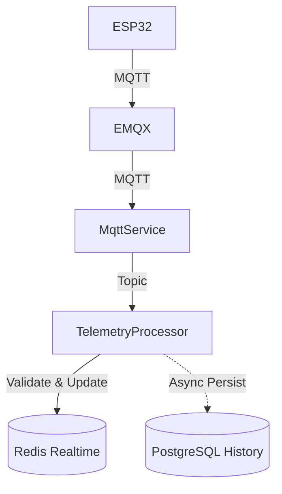

# Telemetry Pipeline Documentation

## 1. Architecture

The telemetry pipeline uses a fast realtime path via Redis and an asynchronous persistence path via PostgreSQL to minimize latency.



- **MqttService**: Handles MQTT connections, subscriptions, and raw payload forwarding.
- **TelemetryProcessor**: Validates structure, sequences, bounds, and routes data.
- **TelemetryRealtimeService**: Maintains the latest device state in Redis with a TTL of 1 hour.
- **TelemetryPersistenceService**: Persists historical data to PostgreSQL and logs device status.

## 2. MQTT Topic & Payload Schema

- **Topic**: `greenhouse/{greenhouseId}/{deviceId}/telemetry`
- **Topic Parser**: Uses `parseGreenhouseTopic` (from `mqtt.constants.ts`) to ensure single-source-of-truth.

### Payload Schema
```json
{
  "seq": 12345,
  "ts": 1780270000000,
  "sensors": [
    {
      "code": "TEMP01",
      "value": 28.5,
      "unit": "°C"
    }
  ]
}
```

## 3. Validation

- **Device Validation**: The payload is cross-referenced with PostgreSQL. Telemetry is dropped from persistence if the `deviceId` isn't registered to the `greenhouseId`.
- **Sensor Validation**: Unknown sensors are ignored gracefully; valid sensors are persisted.
- **Timestamp Validation**: Device timestamps are verified not to exceed current time + 1 hour tolerance.
- **Idempotency & Deduplication**: Managed using `deviceId` + `sequence`. Duplicates are dropped at the Processor layer and protected by a `@@unique([deviceId, sequenceNumber])` constraint in PostgreSQL.
- **Out of Order Handling**: Older sequences skip the realtime Redis update to prevent stale data overlay, but are persisted to PostgreSQL for historical completeness.

## 4. State & Lifecycle

- **Redis Keys**: 
  - `realtime:device:{deviceId}` (Stores JSON state)
  - `realtime:greenhouse:{greenhouseId}:devices` (Set of devices)
- **TTL**: 3600 seconds.
- **Online/Stale/Offline**: Calculated dynamically based on `lastSeenAt`.
  - `ONLINE`: <= 15s
  - `STALE`: > 15s and <= 30s
  - `OFFLINE`: > 30s

## 5. PostgreSQL Schema

Two main models:
- **TelemetryRecord**: Contains raw payload, device info, sequence, and timestamps.
- **TelemetryValue**: Normalizes the sensors array into individual rows for efficient granular queries.

## 6. Failure Handling

- **Redis Failure**: MQTT consumer will not crash; errors are logged (`[REALTIME_ERROR]`), and persistence continues asynchronously.
- **PostgreSQL Failure**: Persistent layer is asynchronous; DB failures trigger structured logging (`[PERSIST_ERROR]`) without interrupting the realtime Redis flow.
- **EMQX Disconnects**: `MqttService` handles auto-reconnects and subscription restores seamlessly.

## 7. APIs

- **`GET /api/devices/:id/telemetry/latest`**: Fetches dynamic state from Redis.
- **`GET /api/greenhouses/:id/telemetry/latest`**: Fetches realtime snapshot of all devices in greenhouse.
- **`GET /api/devices/:id/telemetry/history`**: Paginated Postgres fetch. Supports `limit`, `from`, and `to` query parameters.

## 8. Benchmark Profile
The architecture splits realtime (fast path) and history (async path) making the node process capable of easily handling 100+ msg/sec without blocking the event loop or generating realtime response latency.
